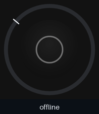

# Rosie

**R.O.S.I.E.: Reminders, Organization, Study, Insight, Execution.**

Rosie is a personal AI chief of staff that lives on a Windows laptop as a floating orb,
answers on Telegram from the phone, and keeps her own second brain in a separate
Obsidian vault. Say "Hey Rosie" and she tells you what matters today.

> Status: **v0.5 "opens at login"** ([walkthrough](docs/WALKTHROUGH-v0.5.md)). Sprint 6 (coaches + ship) next. See [docs/PLAN.md](docs/PLAN.md).



New here? Read the [user guide](docs/USER-GUIDE.md).

## What she will do (v1.0)

- Wake on "Hey Rosie" or Ctrl+Space and brief you: top 3 tasks, schedule, what's overdue
- Remind you on the desktop or on Telegram, depending on where you are
- Remember what you tell her, in her own vault (`rosie-vault`), never touching your notes
- Coach study and training: log sessions, spot skipped subjects, track progression
- Start automatically at login, with a "Day Ring" orb that shows your day at a glance

## Design choices

| Choice | Why |
| --- | --- |
| Local LLM via Ollama, free-tier cloud fallback | Free to run, private by default |
| Separate `rosie-vault` + read-only access to your vault | Your notes are never modified |
| All data on `D:\Rosie` (Windows) | Keeps the system drive clean |
| Python core + Tauri UI | One language for AI/voice/bot; tiny native desktop app |

## Try it

First-time setup on Windows: [docs/SETUP-WINDOWS.md](docs/SETUP-WINDOWS.md), then `rosie doctor`.

```bash
ollama pull qwen3:8b      # once
rosie chat                # /help, /tools, /reset, /exit
```

Today she can tell the time, read and search your Obsidian vault (set `user_vault_dir` in
`config/rosie.yaml`), remember facts and manage tasks in her own vault (`rosie vault` sets
it up), set reminders, and send a morning brief and nightly review (`rosie brief`,
`rosie review`, or on Telegram with `rosie telegram`). Try: "what's in my DBMS note?",
"add revise DBMS for friday", "remind me at 9pm to call mom".

Hands-free: `pip install -e ".[voice]"`, then `rosie voice` and say "Hey Rosie, what's on
today?" ([docs/VOICE.md](docs/VOICE.md)).

On the desktop: the orb (`ui/`, Tauri + React) floats bottom-right with the Day Ring
around it; right-click or Ctrl+Space opens the Command Deck. It starts `rosie serve` for
you and, once installed, opens at login ([docs/UI.md](docs/UI.md)).

When Rosie wants to do something that needs your yes (see `config/permissions.yaml`),
she asks `Allow? [y/N]` in the terminal; anything but `y` means no.

## Development

```bash
python -m pip install -e ".[dev]"
ruff check . && ruff format --check .
python -m pytest
```

The orb UI lives in `ui/` (Tauri 2 + React): see [docs/UI.md](docs/UI.md). All test layers,
including the browser end-to-end tests: [docs/TESTING.md](docs/TESTING.md).

Configuration: copy `config/rosie.example.yaml` to `config/rosie.yaml` and `.env.example`
to `.env`. Secrets live only in `.env`.

Architecture: [docs/ARCHITECTURE.md](docs/ARCHITECTURE.md). Credits: [CREDITS.md](CREDITS.md).

## License

MIT
