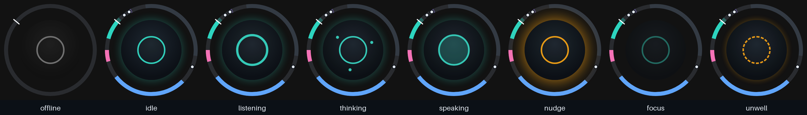
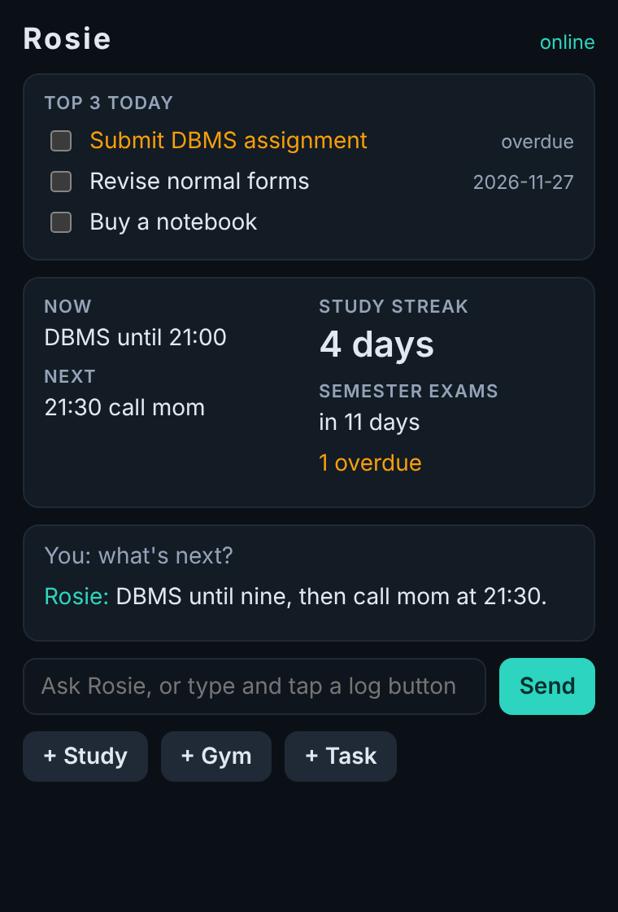

# Rosie user guide

Rosie is your chief of staff: she keeps your tasks, reminders, study and training in
her own Obsidian vault (rosie-vault), reads your notes without ever changing them, and
talks to you on the desktop, by voice and on Telegram. Everything runs on your laptop
for free (Ollama); a free cloud model is only a fallback.


## Install (once)

[SETUP-WINDOWS.md](SETUP-WINDOWS.md): install Python, Git and Ollama, then run
`scripts\install-windows.ps1`. Add `-Orb` to build the desktop app, `-Voice` for voice.

## Everyday use

| You want to... | Do this |
| --- | --- |
| Ask anything | Right-click the orb (or Ctrl+Space) and type; or `rosie chat`; or Telegram |
| Talk hands-free | "Hey Rosie, what's on today?" (core started with `rosie serve --voice`) |
| Add a task | "add revise DBMS for friday", or type it and tap **+ Task** |
| Tick a task | Tick it in the Command Deck, or "done with revise DBMS" |
| Get reminded | "remind me at 9pm to call mom", "every weekday at 7 to stretch" |
| Log study | "start studying DBMS" ... "done", or type `DBMS 45m` and tap **+ Study** |
| Log a workout | "bench 3x8 at 40 kg", or type it and tap **+ Gym** |
| Be quizzed | "quiz me on DBMS" (from your own DBMS note) |
| See how study is going | "how's my studying?" |
| See training progress | "how's my training?" |
| Morning brief | Arrives at 07:30 (toast or Telegram); `rosie brief` any time |
| Nightly review | Three questions at 22:00 on Telegram; `rosie review` in the terminal |

## The orb



Teal and breathing: all good. Grey: the core isn't running (it restarts itself). Amber
pulse: a reminder (click to dismiss). Dashed amber: something needs fixing (click to see
what). Dim: you're in a study block, so only urgent reminders show. The ring around it
is your day: faint blocks fill in as time passes; dots are reminders.

Details: [UI.md](UI.md).

## The Command Deck



## Your day, your subjects

Put your usual week in `config\rosie.yaml` (examples in `config\rosie.example.yaml`):

```yaml
day_blocks:
  - { start: "09:00", end: "15:30", kind: college, days: [mon, tue, wed, thu, fri] }
  - { start: "19:00", end: "21:00", kind: study, label: "Study" }
subjects: [DBMS, OS, Java, Maths]
countdowns:
  - { label: "Semester exams", date: "2027-05-10" }
```

## What Rosie may do on her own

`config\permissions.yaml` is yours: `allow` (she just does it), `ask` (she asks
first, in the deck, the terminal or Telegram; no answer means no) or `deny`. Your own
vault is always read-only.

## Where things are

| What | Where |
| --- | --- |
| Rosie's notes (tasks, memory, logs, daily notes) | `D:\Rosie\rosie-vault` (open it in Obsidian) |
| Daily backups (last 14) | `D:\Rosie\backups` |
| Logs, including every tool call | `D:\Rosie\logs` |
| Settings | `config\rosie.yaml`; secrets only in `.env` |

## When something's wrong

Run `rosie doctor`: every `[fail]` line says what to fix. More in
[RELIABILITY.md](RELIABILITY.md). Coaches: [COACHES.md](COACHES.md). Always-on server:
[SERVER.md](SERVER.md). Voice: [VOICE.md](VOICE.md). Telegram: [SETUP-TELEGRAM.md](SETUP-TELEGRAM.md).
